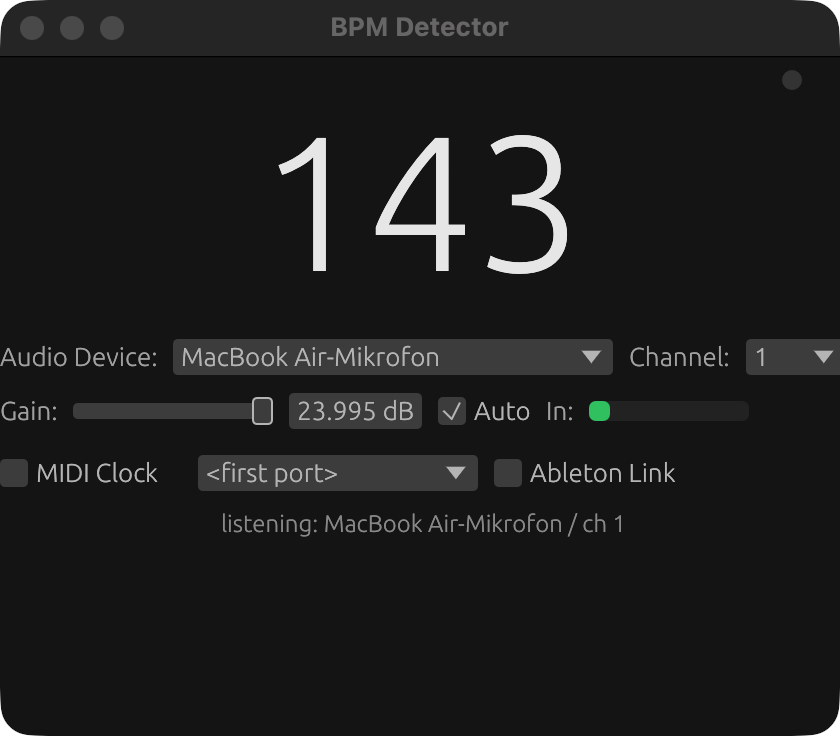

# BPM Detector

Minimaler Echtzeit-BPM-Detektor. Reines Rust, eine kleine Binärdatei für **macOS, Windows und Linux** (inklusive Raspberry Pi).

Entstanden aus [diesem r/DJs-Thread](https://www.reddit.com/r/DJs/comments/1ldp77l/does_this_exist_a_minimal_macos_or_ios/).



## Funktionen

- **Echtzeit-BPM-Erkennung** via [aubio](https://aubio.org) (SpecFlux Onset + Beat-Tracking), sample-genaue Beat-Zeiten, Halbe/Doppelte-Tempo-Korrektur, Median-Glättung und Ausreißer-Verwerfung
- **Schnelles Tempo-Tracking** — übernimmt Pitch-Fader-Änderungen innerhalb von ~2 Schlägen
- **Beat-LED** — blitzt auf der tatsächlichen hörbaren Transiente (Kick/Snare), sample-genau, nicht auf der geglätteten Zahl
- **Auto-Gain** — hält den Eingangspegel automatisch im Optimalbereich (standardmäßig an)
- **Audio-Geräte- & Kanalwahl**, Eingangsverstärkung (-24…+24 dB) und Pegelanzeige
- **MIDI Beat Clock**-Ausgang (24 PPQ, drifkompensiert)
- **Ableton Link** — überträgt das erkannte Tempo an Ableton, Resolume, Traktor, …
- Native GUI ([egui](https://www.egui.rs)), keine JS-Runtime, ~5-MB-Binary

## Download

Fertige Binaries gibt es unter [Releases](../../releases) (macOS arm64/x64, Linux x64/arm64, Windows x64) oder selbst bauen:

```sh
cd app
cargo build --release
# Binary: app/target/release/bpmdetector
```

Unter Linux werden aubio und eine C++-Toolchain benötigt: `sudo apt install libaubio-dev g++` (auf dem Raspberry Pi aubio ggf. aus den Quellen bauen).

## Verwendung

1. App starten, Audio-Gerät und Kanal wählen
2. Musik spielen — die BPM erscheinen nach wenigen Schlägen
3. Nach Bedarf **MIDI Clock** und/oder **Ableton Link** aktivieren

Die Beat-LED oben rechts blitzt auf den erkannten Schlag des eingehenden Signals.

### QLC+ (Licht)

QLC+ konsumiert MIDI Beat Clock direkt (Kanal 531 = Beat, [Doku](https://www.qlcplus.org/old/docs/html_en_EN/midiplugin.html)):

1. Detector starten, MIDI Clock aktivieren
2. MIDI-Port verbinden (physisch oder ALSA-Loopback unter Linux)
3. In QLC+ das MIDI-Plugin als Input patchen und den Beat-Trigger auf Kanal 531 legen

### Ableton Link

Die Link-Checkbox aktivieren, um der Link-Session im Netzwerk beizutreten. Erkannte Tempo-Änderungen werden in die Session übertragen; Peers folgen automatisch.

### System-Audio (Loopback)

Der Detector hört auf Mikrofon-/Line-Eingänge. Um System-Audio direkt zu analysieren:

- **macOS**: [BlackHole](https://existential.audio) (kostenlos) installieren, ein Multi-Output-Gerät anlegen und BlackHole als Eingang wählen
- **Windows**: WASAPI-Loopback ist geplant
- **Linux**: eine Monitor-Quelle des Ausgabegeräts wählen (PipeWire/PulseAudio)

## Entwicklung

```sh
cd app
cargo test          # Detector-Logik, aubio-Integration, MIDI-Clock-Timing
cargo run --release # GUI
```

CI (`.github/workflows/`):

- `ci.yml` — Test + Build auf macOS, Windows, Linux; Cross-Build für aarch64 Linux (Raspberry Pi)
- `release.yml` — bei Tag `v*`: Artefakte für macOS (arm64/x64), Linux (x64/arm64), Windows (x64)

## Aufbau

```
app/
├── src/         # bpm, Audio-Capture, MIDI-Clock, Link, GUI
├── link/        # ableton-link-Crate: C++-Bridge + mitgeführtes SDK
└── tests/       # Integrationstests (synthetische Click-Tracks, MIDI-Timing)
```

## Lizenz

[MIT](LICENSE)

---

[English version](README.md)
