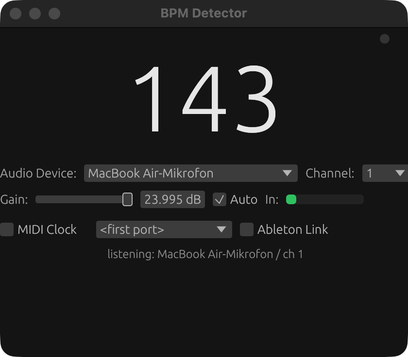

# BPM Detector

Minimal real-time BPM detector. Pure Rust, one small binary for **macOS, Windows and Linux** (including Raspberry Pi).

Born from [this r/DJs thread](https://www.reddit.com/r/DJs/comments/1ldp77l/does_this_exist_a_minimal_macos_or_ios/).



## Features

- **Real-time BPM detection** via [aubio](https://aubio.org) (SpecFlux onset + beat tracking), sample-accurate beat timing, half/double tempo folding, median smoothing and outlier rejection
- **Fast tempo tracking** — adopts pitch-fader tempo changes within ~2 beats
- **Beat LED** — flashes on the actual audible transient (kick/snare), sample-accurate, not on the smoothed number
- **Auto gain** — keeps the input level in the sweet spot automatically (on by default)
- **Audio device & channel selection**, input gain (-24…+24 dB) and level meter
- **MIDI Beat Clock** output (24 PPQ, drift-compensated)
- **Ableton Link** — share the detected tempo with Ableton, Resolume, Traktor, …
- Native GUI ([egui](https://www.egui.rs)), no JS runtime, ~5 MB binary

## Download

Grab a prebuilt binary from [Releases](../../releases) (macOS arm64/x64, Linux x64/arm64, Windows x64) or build it yourself:

```sh
cd app
cargo build --release
# binary: app/target/release/bpmdetector
```

On Linux you need aubio and a C++ toolchain: `sudo apt install libaubio-dev g++` (or build aubio from source on Raspberry Pi).

## Usage

1. Start the app, pick your audio device and channel
2. Play music — the BPM appears within a few beats
3. Enable **MIDI Clock** and/or **Ableton Link** as needed

The beat LED in the top-right corner flashes on the detected beat of the incoming signal.

### QLC+ (lighting)

QLC+ consumes MIDI Beat Clock directly (channel 531 = beat, [docs](https://www.qlcplus.org/old/docs/html_en_EN/midiplugin.html)):

1. Start the detector, enable MIDI Clock
2. Connect the MIDI port (physical or ALSA loopback on Linux)
3. In QLC+, patch the MIDI plugin as input and map the beat trigger to channel 531

### Ableton Link

Enable the Link checkbox to join the Link session on your network. Detected tempo changes are pushed into the session; peers follow automatically.

### System audio (loopback)

The detector listens to microphone/line inputs. To analyze system audio directly:

- **macOS**: install [BlackHole](https://existential.audio) (free), create a Multi-Output Device and select BlackHole as input
- **Windows**: WASAPI loopback support is planned
- **Linux**: select a monitor source of your output device (PipeWire/PulseAudio)

## Development

```sh
cd app
cargo test          # detector logic, aubio integration, MIDI clock timing
cargo run --release # GUI
```

CI (`.github/workflows/`):

- `ci.yml` — test + build on macOS, Windows, Linux; cross-build for aarch64 Linux (Raspberry Pi)
- `release.yml` — on tag `v*`: artifacts for macOS (arm64/x64), Linux (x64/arm64), Windows (x64)

## Layout

```
app/
├── src/         # bpm, audio capture, midi clock, link, gui
├── link/        # ableton-link crate: C++ bridge + vendored SDK
└── tests/       # integration tests (synthetic click tracks, MIDI timing)
```

## License

[MIT](LICENSE)

---

[Deutsche Version / German version](README.de.md)
